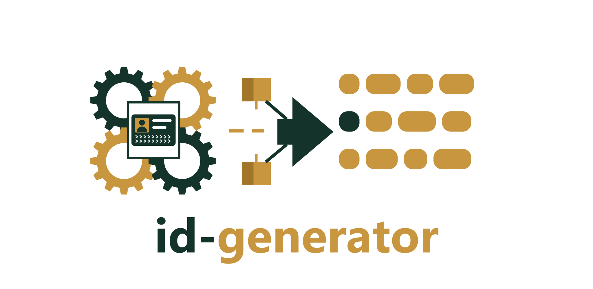

# ID Generator for C++

> **Requires C++23** (e.g., `-std=c++23` for GCC/Clang, `/std:c++latest` for MSVC).

[](https://github.com/dasmig/id-generator/releases)

[](https://raw.githubusercontent.com/dasmig/id-generator/main/LICENSE.MIT)
[](https://github.com/dasmig/id-generator/actions/workflows/ci.yml)
[](https://github.com/dasmig/id-generator/releases)
[](https://en.cppreference.com/w/cpp/23)
[](https://github.com/dasmig/id-generator#integration)
[](https://dasmig.github.io/id-generator/)

**[API Reference](https://dasmig.github.io/id-generator/)** · **[Usage Guide](doc/usage.md)** · **[Data and Method](doc/data.md)** · **[Releases](https://github.com/dasmig/id-generator/releases)**

Identity numbers and documents that fit a person and a date: national numbers for 63 countries, built from the birth date, sex, birthplace and names where the country's format encodes them, and passports for all 199 countries and identity cards for the 182 known to issue them, valid on the date, with an ICAO 9303 machine-readable zone.

```
BR, Individual Taxpayer Registry number 541.648.695-35, passport 0H223687 (valid to 2032-05-03)
SE, Personal identity number 198107082391, passport 0H2236871 (valid to 2027-11-12)
FR, Social security number (NIR, INSEE number) 1 81 03 84 031 370 28, passport X3GF36871 (valid to 2032-05-04)
US, Social Security number 000-60-5014, passport A3223687 (valid to 2032-05-03)
```

These examples use `safe`, so nobody holds them.

## Limits

- Realistic numbers, the default, are structurally valid and may coincide with a real person's number, because many national number spaces are densely assigned.
- They are test data. Never use them to identify anyone, to open accounts or to pass identity checks.
- The library looks nothing up and cannot tell whether a number is in use.
- Documents are data, not images. The library draws no document likeness.

## Features

- **National Numbers**. 65 schemes in 63 countries, among them the CPF, the codice fiscale, the CURP, the NIR, the Aadhaar, the SSN and China's resident identity number. Each has its structure and check digit right, and `doc/data.md` lists the sources, and the seven countries left unserved and why (no published structure or check digit).

- **Coherent with the Person**. A number encodes the birth date, sex, place and name given, and a date a scheme changed changes the number: Finland's new century signs, Korea's random digits from October 2020, the SSN's randomization in 2011. Sequential numbers (the SSN before 2011, Argentina's DNI, Chile's RUN) follow the date the person got them. A number the person cannot hold yet is left out.

- **Documents**. Passports for 199 countries and identity cards for 182, the one the person holds on the reference date: issued within its validity, in the format in use that day, with the expiry rule for the age at issue. Each result says how its format is known: 113 passports and 93 identity cards have no format we could find, and these get a stand-in marked `evidence = "generic"`.

- **Machine-Readable Zones**. Lines and check digits by ICAO Doc 9303, with its transliteration tables for Latin and Cyrillic names, the national rules of five countries and its way of shortening long names.

- **Safe Mode**. `safe = true` gives numbers and documents nobody holds. Each scheme declares its method: published test numbers, reserved ranges, unissued series, unassigned places, a wrong check digit or an impossible date. `doc/data.md` says which validators each one passes, and where the promise is weak.

- **Checking Text**. `is_valid(scheme, text)` checks a number's structure, check digit and encoded date.

- **Composes with the Others**. Given names, birth dates, places and sex are plain values, so results of [name-generator](https://github.com/dasmig/name-generator), [birth-generator](https://github.com/dasmig/birth-generator) and [city-generator](https://github.com/dasmig/city-generator) go straight in. Anything left out is drawn.

- **Independently Checked**. Every served country's numbers are read back by python-stdnum or by code written from the national rules, and the zones by a separate ICAO 9303 implementation. Neither ships with the library.

- **Deterministic**. Per-call `get_identity(request, seed)` gives the same result on every compiler, standard library and CPU (GCC, Clang, MSVC, Emscripten; x86-64 and ARM64), checked by known-answer tests, and `identity::seed()` replays a previous result with the same request and data.

- **Batch Generation**. Generate thousands of results from one seed, on several threads with the same output for any thread count, optionally unique by a key, and stream them as JSON Lines or CSV (see the usage guide).

- **Extensible Data**. Load your own TSV layers on top of the shipped data to add a country, a scheme, a place or a document format (`extend()`), checked before they are applied.

- **JSON and Replay**. `to_json()` on every result, and a `signature()` recording the seed and the data it came from.

- **Compiled-in Data**. Define `DASMIG_ID_EMBED` to build the `lite` tier into the program, for WebAssembly and other builds without files.

- **Multi-Instance Support**. Construct independent `idg` instances with their own data and random engine.

## Integration

[`idgen.hpp`](https://github.com/dasmig/id-generator/blob/main/dasmig/idgen.hpp) is the library [released here](https://github.com/dasmig/id-generator/releases). Keep [`core.hpp`](https://github.com/dasmig/id-generator/blob/main/dasmig/core.hpp) and the [`core/`](https://github.com/dasmig/id-generator/tree/main/dasmig/core) directory ([dasmig-core](https://github.com/dasmig/dasmig-core)) in the same directory. Add

```cpp
#include <dasmig/idgen.hpp>
```

to the files you want to use it in, and supply the [`resources`](https://github.com/dasmig/id-generator/tree/main/resources) folder (or define `DASMIG_ID_EMBED`).

## Usage

```cpp
#include <dasmig/idgen.hpp>
#include <iostream>

auto& gen = dasmig::idg::instance(); // loads the lite tier

// A codice fiscale from a name, a birth date and a commune.
dasmig::identity_request request;
request.country = "IT";
request.surname = "Rossi";
request.given_names = "Mario";
request.birth_date = std::chrono::year{1980} / 1 / 1;
request.sex = dasmig::sex::male;
request.birthplace = dasmig::id_place{.country_code = "IT", .geonameid = 3169070U}; // Rome

auto v = gen.get_identity(request, 42);   // the same seed gives the same result everywhere
std::cout << v << '\n';                   // IT, Tax code RSSMRA80A01H501U
std::cout << v.to_json() << '\n';         // {"country_code":"IT","birth_date":"1980-01-01",...}

// A passport with its zone, and a number and document nobody holds.
dasmig::identity_request traveller;
traveller.country = "DE";
traveller.surname = "Müller";
traveller.given_names = "Jürgen Karl";
traveller.documents = {dasmig::id_document_kind::passport};
traveller.safe = true;

auto t = gen.get_identity(traveller, 11);
std::cout << t << '\n'; // DE, Tax identification number 07 184 633 236, passport XL9KM58HC (valid to 2024-04-02)
t.documents.front().mrz; // {"P<D<<MUELLER<<JUERGEN<KARL<<<<<<<<<<<<<<<<<<",
                         //  "XL9KM58HC3D<<8911252M2404026<<<<<<<<<<<<<<06"}

// Or draw a whole person: the country by population, then everything else.
auto anyone = gen.get_identity(dasmig::identity_request{});

gen.is_valid("br-cpf", "111.444.777-35"); // true
gen.is_valid("br-cpf", "111.444.777-36"); // false
```

See the [usage guide](doc/usage.md) for everything else.

## Building

```bash
make            # example
make test       # tests
make bench      # benchmarks, results in build/bench.tsv
make test-embed # tests with the lite tier compiled in
make coverage   # code coverage
make lint       # clang-tidy
make docs       # API docs
make embed      # regenerate dasmig/idgen_data.hpp from resources/lite
```

## Compiler Support

Tested with:
- Clang 18+ (`-std=c++23`)
- GCC 14+ (`-std=c++23`)
- MSVC 19.38+ (`/std:c++latest`)
- Emscripten 3.1.74

## Dependencies

| Dependency | Version | Bundled | Purpose |
|-----------|---------|---------|---------|
| [dasmig-core](https://github.com/dasmig/dasmig-core) | 1.4 | Yes (`core.hpp`, `core/`) | Platform-independent random engine and distributions, check digits, patterns, data layers, JSON |
| [Catch2](https://github.com/catchorg/Catch2) | 3.x | Yes (amalgamated) | Unit testing |

## Data

The rules are curated for this library from laws, authorities' published rules, reference works and specimens read for their format, with a source for each scheme and document. Place codes come from INSEE, ANPR, Wikidata (CC0), the US Social Security Administration and GeoNames (CC BY 4.0), and the CURP's word list from django-localflavor (BSD); see [doc/data.md](doc/data.md) and [LICENSE_DATA.txt](LICENSE_DATA.txt).

## Related Libraries

| Library | Description |
|---------|-------------|
| [address-generator](https://github.com/dasmig/address-generator) | Postal addresses with real streets by place |
| [biodata-generator](https://github.com/dasmig/biodata-generator) | Procedural human physical characteristics |
| [birth-generator](https://github.com/dasmig/birth-generator) | Demographically plausible birthdays |
| [city-generator](https://github.com/dasmig/city-generator) | Weighted city selection by population |
| [company-generator](https://github.com/dasmig/company-generator) | Companies by country: industry, size, legal form, name, registration numbers and domain |
| [country-generator](https://github.com/dasmig/country-generator) | Weighted country selection by population |
| [device-generator](https://github.com/dasmig/device-generator) | Devices, browsers, user agents and IP addresses that fit together |
| [email-generator](https://github.com/dasmig/email-generator) | Email addresses in each country's style |
| [entity-generator](https://github.com/dasmig/entity-generator) | ECS-based entity generation |
| [finance-generator](https://github.com/dasmig/finance-generator) | Bank accounts and payment cards in each country's form |
| [interest-generator](https://github.com/dasmig/interest-generator) | Religion, hobbies and favourite media by country, age and sex |
| [name-generator](https://github.com/dasmig/name-generator) | Culturally appropriate full names |
| [nickname-generator](https://github.com/dasmig/nickname-generator) | Gamer-style nicknames |
| [occupation-generator](https://github.com/dasmig/occupation-generator) | Employment status, education and occupation by country, age and sex |
| [persona-generator](https://github.com/dasmig/persona-generator) | Complete characters composed from the other generators |
| [phone-generator](https://github.com/dasmig/phone-generator) | Phone numbers valid in each country's numbering plan |
| [property-generator](https://github.com/dasmig/property-generator) | Homes that fit a household: dwelling type, tenure, rooms, size, age and cost |
| [relationship-generator](https://github.com/dasmig/relationship-generator) | Families around a person: parents, siblings, partners and children |
| [trait-generator](https://github.com/dasmig/trait-generator) | Personality traits with conflicts, synergies and Big Five axes |
| [user-generator](https://github.com/dasmig/user-generator) | Complete user records: account, username, email, phone and address |
| [vehicle-generator](https://github.com/dasmig/vehicle-generator) | Cars and motorcycles with plates and VINs that fit their country and date |
| [weather-generator](https://github.com/dasmig/weather-generator) | Daily weather for any place on land and any date |

## License

This library is released under the [MIT License](https://opensource.org/licenses/MIT).

```
MIT License

Copyright (c) 2026 Diego Dasso Migotto
```
